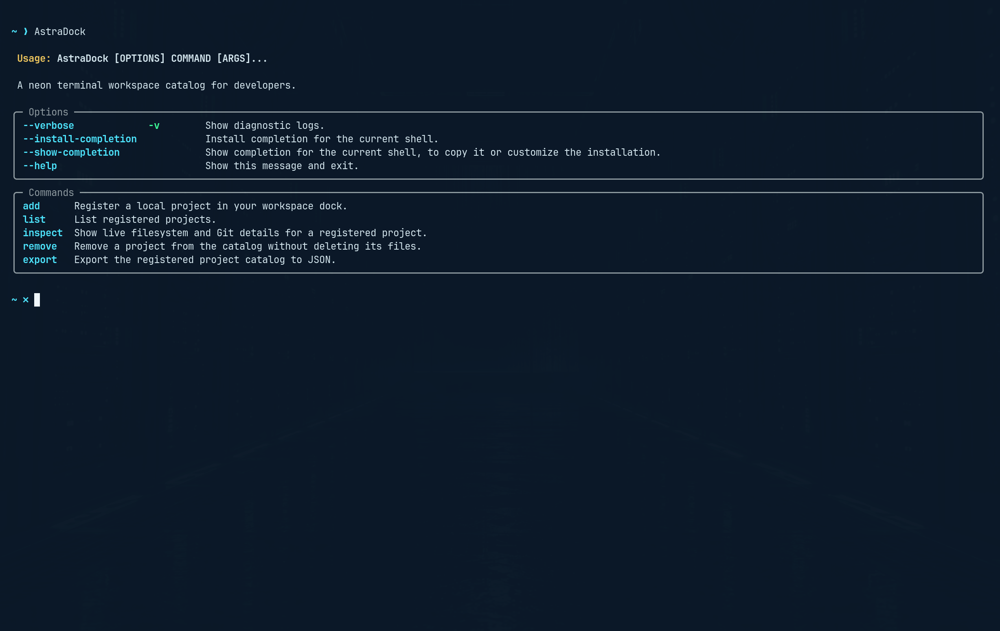

<div align="center">

# AstraDock CLI

**A neon terminal workspace catalog for developers.**

Register local coding projects under short aliases, inspect project metadata
and Git status, keep a persistent SQLite registry, and export the catalog to
JSON.

[](https://www.python.org/)
[](https://github.com/astral-sh/ruff)
[](LICENSE)

</div>



## Features

- Rich terminal tables and styled status output.
- Unique aliases for local project directories.
- Language detection for Python, Go, Rust, C/C++, JavaScript/TypeScript,
  Java, and C#.
- Python source counting that ignores virtual environments and generated
  folders.
- Git branch and working-tree status via safe argument-list subprocess calls.
- Live project inspection with a single command.
- Persistent SQLite registry at `~/.local/share/astradock/projects.sqlite3`.
- JSON export for tooling and backups.
- Tested with pytest, Ruff, mypy, and GitHub Actions CI.
- Safe by design: removing an alias never deletes project files.

## One-line install

Paste this into your terminal to download and install AstraDock:

```bash
curl -fsSL https://raw.githubusercontent.com/Ruby-Sploit-King/astradock-cli/main/install.sh | bash
```

The installer uses [pipx](https://pipx.pypa.io) or [uv](https://docs.astral.sh/uv/)
when available, and falls back to `pip install --user`. When it finishes, run:

```bash
AstraDock
```

## Other install options

With [pipx](https://pipx.pypa.io):

```bash
pipx install git+https://github.com/Ruby-Sploit-King/astradock-cli.git
```

With [uv](https://docs.astral.sh/uv/):

```bash
uv tool install git+https://github.com/Ruby-Sploit-King/astradock-cli.git
```

From a local clone (development):

```bash
git clone https://github.com/Ruby-Sploit-King/astradock-cli.git
cd astradock-cli
python -m venv .venv
source .venv/bin/activate
python -m pip install --upgrade pip
python -m pip install -e ".[dev]"
```

## Requirements

- Python 3.11 or newer.
- Git for Git status inspection.

## Usage

```bash
AstraDock                                             # show the dock
AstraDock add api ~/Projects/my-api                   # dock a project
AstraDock list                                        # list docked projects
AstraDock inspect api                                 # live project details
AstraDock export astradock-export.json                # write a JSON catalog
AstraDock remove api                                   # remove an alias
```

### Commands

| Command   | Description                                                  |
| --------- | ------------------------------------------------------------ |
| `add`     | Register a local project in your workspace dock.             |
| `list`    | List registered projects.                                    |
| `inspect` | Show live filesystem and Git details for a project.          |
| `export`  | Export the registered project catalog to JSON.               |
| `remove`  | Remove an alias from the catalog without deleting its files. |

Use the global `--verbose` / `-v` flag to print diagnostic logs.

### Example session

```text
$ AstraDock add api ~/Projects/my-api
✓ Project docked
Alias: api
Path: /home/you/Projects/my-api
Language: Python

$ AstraDock list
┌────────── ASTRADOCK // WORKSPACE DOCK ──────────┐
│ ALIAS │ PROJECT │ LANGUAGE │ PATH     │ GIT      │
│ api   │ my-api  │ Python   │ /home/.. │ ● tracked│
└─────────────────────────────────────────────────┘
```

## Data and storage

AstraDock stores the catalog in a single SQLite database:

```text
~/.local/share/astradock/projects.sqlite3
```

- Aliases are unique; adding a duplicate is rejected.
- Each record caches name, language, and Git state, refreshed on `inspect`.
- Removing an alias only updates the catalog — your files are untouched.

## Project layout

```text
astradock-cli/
├── main.py                  # Typer CLI and command definitions
├── astradock/
│   ├── models.py            # ProjectRecord dataclass
│   ├── registry.py          # SQLite persistence and JSON export
│   ├── terminal_ui.py       # styled tables and panels
│   └── workspace.py         # project inspection and Git status
├── tests/                   # pytest suite
├── install.sh               # one-line installer
└── docs/                    # screenshots
```

## Development

```bash
python -m venv .venv
source .venv/bin/activate
python -m pip install -e ".[dev]"

ruff check .                 # lint
mypy main.py astradock       # type-check
pytest                       # run the test suite
```

## License

Released under the [MIT License](LICENSE).

---

Built by [Ruby-Sploit-King](https://github.com/Ruby-Sploit-King).
